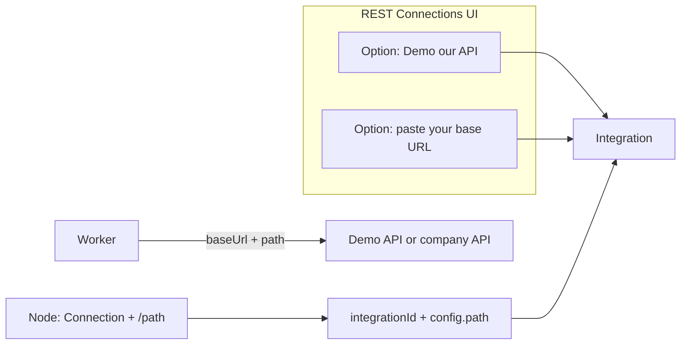

# Connections-first readiness (then Run + Redis)

Goal: **zero connection/data issues** before Phase 4. REST Connections UI is simple: **Demo (our API)** or **paste your URL**; paths live on nodes.

## Locked product rules

| Place | What HR enters |
|-------|----------------|
| **Connections → Company HR / ATS API** | Choose **Demo** (platform HR API) **or** paste **your base URL** — no Bearer / API key |
| **Builder node** | Pick Connection + **`/path`** (method if needed) |
| **Google Workspace** | One OAuth account — unchanged |
| **Webhook** | Destination URL |

Worker later: `{integration.baseUrl}{node.config.path}` (no auth for Custom REST V1).



---

## Current status / data issues

| Issue | Risk |
|-------|------|
| OAuth fields in schema, no migration | Google connect fails on Neon |
| REST UI asks Bearer/API key | Wrong UX |
| POST requires credentials | Blocks URL-only / Demo |
| Nodes can save without Connection/path | Runtime failures later |
| No Run + Redis yet | Simulation only |

---

## Phase A — Migrate OAuth columns

Migration for: `IntegrationType.OAUTH`, `CredentialType.OAUTH2`, `accountIdentifier`, `metadata`, `expiresAt`, `scopes`, index `(userId, provider)`.

Apply to Neon → `prisma generate`.

---

## Phase B — REST UI: Demo OR paste URL

### UI ([`connections/page.tsx`](apps/web/src/app/dashboard/connections/page.tsx))

**Company HR / ATS API** modal — two modes only:

1. **Demo** (recommended for tryouts)
   - One-click / radio: “Use demo HR API”
   - Uses platform base URL from env (e.g. `NEXT_PUBLIC_DEMO_HR_API_URL` or server `DEMO_HR_API_BASE_URL`)
   - Anyone can test the product against **our** attendance/employees-style API
   - Saves Integration with that `baseUrl`, `provider: DEMO_REST` (or `CUSTOM_REST` + `metadata.source=demo`)

2. **Your API**
   - Enter field: HR pastes their company base URL (e.g. `https://hr.company.com`)
   - Optional name field (default “Company HR API”)
   - No token / Bearer / API key fields

Remove from REST form: auth type, Bearer, API key, Basic, headers JSON.

Helper text: “Paths like `/api/attendance/monthly` are set on each workflow node.”

### API ([`integrations/route.ts`](apps/web/src/app/api/integrations/route.ts))

- Create REST: `name` + `baseUrl` required; **credentials not required**
- If body `useDemo: true` → set `baseUrl` from server env (do not trust client to invent demo URL if you want it locked; or accept client preset that matches env)
- No credential row for REST
- Test: ping `baseUrl`

### Env

```text
DEMO_HR_API_BASE_URL=https://your-demo-hr-api.example.com
# optional public mirror for UI label:
NEXT_PUBLIC_DEMO_HR_API_URL=...
```

### Node settings

- Connection dropdown (Demo or custom REST rows)
- Path enter/presets on the node (`/api/employees`, `/api/attendance/monthly`, …)
- Block save without Connection + path
- Preview: `{baseUrl}{path}`

**Exit:** New user picks **Demo** and runs nodes against our API; real customer pastes their URL instead.

---

## Phase C — Readiness

- Require Connection on HR/HTTP nodes before Run  
- Google OAuth error UX on Connections  
- `SEND_EMAIL`: Google OAUTH and/or SMTP  
- `CREDENTIALS_SECRET` for Google tokens  

---

## Phase D — Run + Redis

`POST /api/workflows/[id]/run` → Execution `QUEUED` + BullMQ; webhook shares enqueue helper.

---

## Build order

```text
A Migrate OAuth
→ B REST Demo + paste-URL UI/API
→ C Validation / Google UX
→ D Run + Redis
→ later Worker/engine
```

## Demo definition of done

> Connections → **Demo** (our API) or paste company URL → nodes set paths → Save with no errors → Run Now returns `QUEUED` + Redis job.
